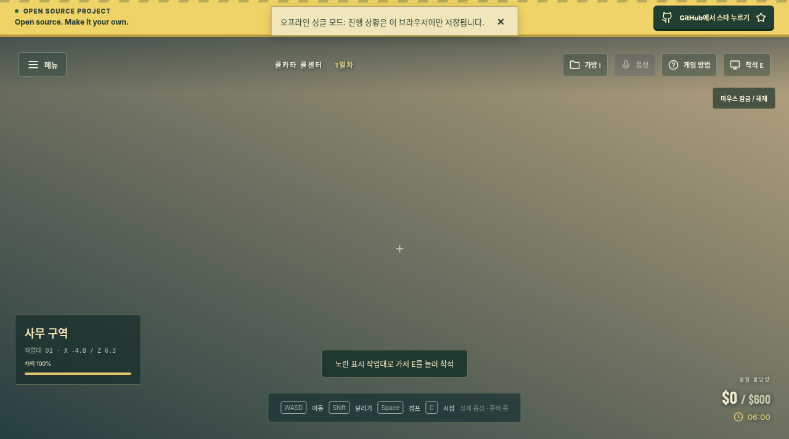
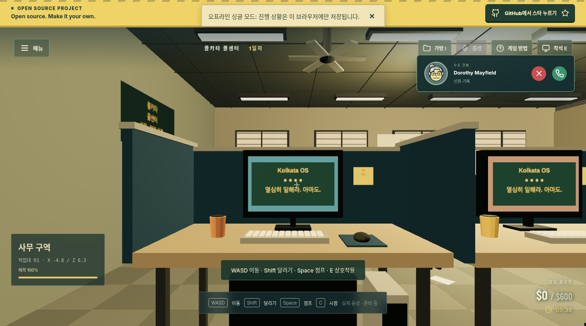
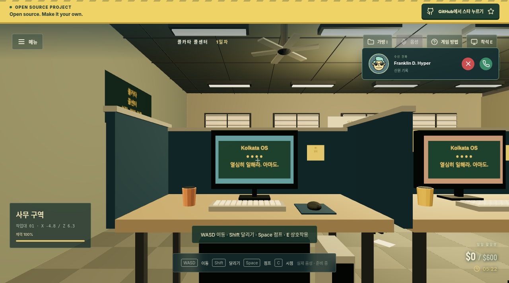

# Scam With Your Friends — Web 한글판 (비공식)

> 친구들과 함께 사기 콜센터를 운영하세요. 점점 황당해지는 수법으로 AI 전화 고객을 속여 할당량을 채우고, 사무실을 난장판으로 만들고, 분노 조절 장애 상사의 혹독한 성과 평가에서 살아남으세요.

원작 게임 설명 · [Steam](https://store.steampowered.com/app/4954910/Scam_With_Your_Friends/)

> **이 저장소는 [mrzh7/scam-with-your-friends-web](https://github.com/mrzh7/scam-with-your-friends-web)의 비공식 한글 포크입니다.**
> 원본은 MIT 라이선스이며 원본 저작권 표기를 유지합니다(LICENSE 참조). 원본 역시 공식 게임이 아닌 **비공식 무료 브라우저 리메이크**입니다.
> 원본 저장소: https://github.com/mrzh7/scam-with-your-friends-web · 원본 데모: https://scam.gamefun.world
> 원본 영문 README: [README.en.md](README.en.md)

**한글판 라이브(정적 배포): https://sigco3111.github.io/scam-with-your-friends-web/**

## 이 한글판의 범위 (중요)

이 포크의 GitHub Pages 배포는 **정적 호스팅**이므로 다음과 같이 동작합니다.

- **싱글 플레이(게스트 모드) 전용**입니다. 게스트 저장은 브라우저 로컬에만 보관됩니다.
- 온라인 협동(최대 4인, WebSocket 방 코드), 팀 음성 채팅(WebRTC), 계정 로그인(Google/이메일),
  클라우드 저장(D1), 선택적 AI 대화/TTS 등 **서버(Cloudflare Workers)가 필요한 기능은 이 배포에서
  제공되지 않습니다**. 원본 저장소를 자체 호스팅하면 사용할 수 있습니다(원본 문서 `docs/DEPLOYMENT.md` 참조).
- 오프라인 스크립트 응답, 사무실 이동/상호작용, 데스크톱 작업, 상점, 일일 할당량과 성과 평가 등
  **클라이언트만으로 동작하는 싱글 플레이 루프는 그대로 플레이할 수 있습니다.**

## 게임 소개 (원본 기준)

**Scam With Your Friends — Web**은 브라우저에서 즐기는 협동 AI 콜센터 게임입니다. 3D 사무실, 가상의
전화 고객, 일일 할당량을 특징으로 하며 React, Three.js, Cloudflare Workers로 만들어졌습니다.
원작 공식 게임은 [Steam](https://store.steampowered.com/app/4954910/Scam_With_Your_Friends/)에서
확인하세요. 이 저장소는 원작 개발사와 **무관한 비공식 팬 메이드**입니다.

- 8종의 가상 AI 전화 고객, 신뢰/인내 관리, 키 없이 동작하는 오프라인 스크립트 응답
- 7일 근무, 상승하는 일일 할당량, 상점과 배달 수령, 인벤토리, 돌발 사고, 성과 평가
- 바이러스·정전·화재·급습 등 사무실 돌발 사고
- 모든 것이 가상입니다. **실제 결제 정보를 절대 입력하지 마세요.**

## 플레이 방법

1. **책상에 앉기** — WASD로 이동, **E**로 앉기. 모바일은 화면 컨트롤.
2. **전화 받기** — AI 고객의 신뢰와 인내를 관리하며 오프라인 응답 버튼 사용.
3. **데스크톱 작업 완료** — 게임 내 돈을 위해 인증 절차 완료(실제 카드 정보 금지).
4. **상점과 배달 수령** — 업그레이드는 즉시 설치, 실물 아이템은 사무실에서 수령.
5. **일일 할당량 달성** — 근무 타이머 종료 전 달성하고 성과 평가 통과. 실패하면 런 종료.

## 한글화 범위와 검증

- UI/게임 텍스트 카탈로그 전체(1,419키)를 한글로 번역했습니다. 브랜드명, 단축키(WASD), URL 스킴 등
  일부 항목은 의도적으로 원문을 유지했습니다.
- 실제 배포 빌드에서 게스트 부팅과 싱글 플레이 진입, 한글 UI 표시를 검증했습니다(아래 스크린샷).
- 언어 전환: 게임 설정에서 한국어 선택(브라우저 로컬스토리지 `swyf-language`에 저장).

### 배포 검증 스크린샷

실제 배포 빌드(https://sigco3111.github.io/scam-with-your-friends-web/)에서 촬영했습니다.

| 한글 HUD로 근무 시작 | 3D 사무실 + 수신 전화 | 게임 루프 진행 |
| --- | --- | --- |
|  |  |  |

- 게스트("게스트 직원") 부팅 → 1일차 시작 → 3D 사무실 렌더 → 근무 타이머 실시간 진행(06:00부터 감소) 확인
- 수신 전화 팝업(응답/거절) 클릭 입력 동작 확인, HUD 전면 한글(일일 할당량, 체력, 조작 안내)

## 2차 한글화 점검 (2026-11-05)

처음 배포본은 번역 카탈로그만 확인해 일부 화면이 한글로 연결되지 않았습니다. 실제 플레이 화면을 기준으로 다시 점검해 아래를 고쳤습니다.

- 통화 말풍선에서 플레이어 대사가 중국어 원문으로 보이던 문제
- Scamazon 상품명 11개가 중국어로 보이던 문제와 상품 부제(영어 12개) 번역
- 상단 오픈소스 배너의 영어 문구
- 앱 이름 Dispatch / Studio / Workshop을 배차 / 스튜디오 / 작업실로 변경 (Scamazon, Malwarebits, Kolkata OS 등 고유 브랜드와 인물 이름은 원문 유지)
- 번역 함수를 거치지 않고 화면에 나오는 중국어를 카탈로그로 대체하는 안전망(`src/i18n/domFallback.ts`). 입력창과 저장 데이터는 건드리지 않습니다.
- 회귀 테스트 `tests/ko-runtime-coverage.test.ts`: 플레이 중 생성되는 문자열이 한국어로 번역되는지 확인

확인 범위: 최신 빌드로 앱 전체 열람, 전화 응답과 대화 선택지 진행, 4일차 화재 이벤트, 5일차 성과 평가, 7일차 승리 화면에서 중국어 텍스트가 보이지 않는 것을 확인했습니다. 3D 사무실 안의 간판 글자와 그 밖의 모든 이벤트 조합을 전부 확인한 것은 아니므로, 남은 번역 누락을 발견하면 알려 주세요.

## 원본 문서

설치/자체 호스팅/개발 문서는 원본과 동일합니다: `docs/QUICKSTART.md`, `docs/DEPLOYMENT.md`,
`docs/EXPANSION.md`, `THIRD_PARTY_NOTICES.md` 등. 다언어 README: [English](README.en.md) ·
[简体中文](README.zh-CN.md) · [Português](README.pt-BR.md) · [Español](README.es.md) ·
[日本語](README.ja.md) · [Deutsch](README.de.md) · [Русский](README.ru.md)

## 라이선스

원본과 동일하게 MIT 라이선스입니다. [LICENSE](LICENSE) 참조.
